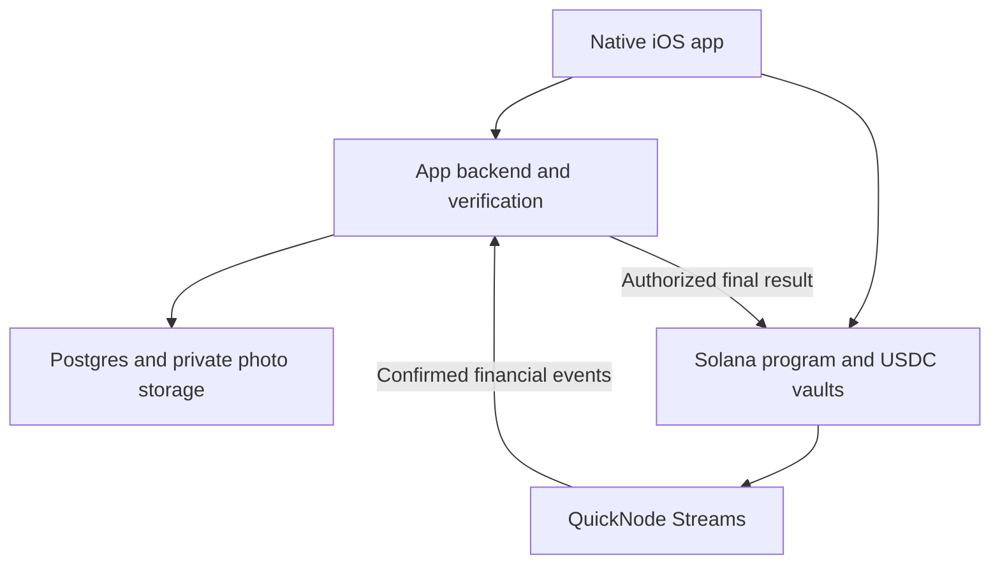

# Lock&Run

## Product overview

**Lock your stake. Run with friends. Finish the challenge and share the rewards.**

Lock&Run is a social running app where friends commit USDC to a shared challenge, record their runs, and post one photo check-in per day. At the end of the challenge, participants who meet the agreed goal share the prize pool. Users can also earn sponsor offers and spend their rewards on partner vouchers.

The primary audience is college students and young adults who want a reason to keep running together. The daily experience centers on friends, photos, progress, and streaks. Solana holds the participants’ stakes and enforces the agreed payout rules.

**Document status — planning specification.** This document consolidates the conversation into a proposed MVP architecture. Suggested defaults are identified below. Development, deployment, sponsor agreements, and device testing are still pending.

## 1. A typical challenge

Five friends join a running room and each commit 10 USDC. Their goal is to complete a qualifying 3 km run on at least 20 different days during a 30-day challenge.

A participant starts a session, runs outdoors or on a treadmill, and takes a photo afterward. The app evaluates the recorded movement and updates the participant’s daily check-in. Friends see the photo, qualifying distance, streak, and progress toward the monthly goal.

If three participants finish, they share the pool according to the room’s published rules. If a sponsor has committed an additional reward, that funded reward is included under the same rules.

The participant can claim the reward to their wallet and optionally use it for a partner voucher.

### Proposed MVP defaults

These defaults turn the discussion into an implementable first version. They can be changed before implementation.

| Setting | Proposed default |
| --- | --- |
| Main track | Consumer Applications |
| Chain award | Best use of Solana |
| Network | Solana Devnet |
| Stake asset | Test USDC, using a verified devnet mint |
| Room size | Five friends |
| Stake per participant | 10 USDC |
| Challenge duration | 30 calendar days |
| Completion target | 20 qualifying days |
| Qualifying run | One recorded session reaching an estimated 3 km, followed by a photo check-in |
| Daily check-ins | One approved check-in per participant per room day |
| Calendar | One fixed room time zone, displayed before joining |
| Streak | Consecutive qualifying room days |
| Participation deadline | Before the challenge begins |
| Settlement fee | 5% of forfeited participant stakes |
| Result review window | A defined period after the final check-in deadline, proposed as 24 hours |
| Result submission timeout | A later published deadline, proposed as 48 hours after the final check-in deadline |
| Primary implementation | Native iOS app |
| First bounty target | QuickNode Streams |

The room stores its minimum participant count. For the first five-person demo, the minimum equals the room capacity. Once the first participant deposits, the room’s financial rules, schedule, goal, and verification policy are fixed.

## 2. Core user experience

### Join and commit

1. Open a friend’s invitation link.
2. Sign in and create a profile.
3. Connect a supported Solana wallet.
4. Review the goal, stake, time zone, completion rule, fees, verification policy, and refund conditions.
5. Approve the deposit transaction.
6. See the entry become confirmed after onchain confirmation.

Show the stake in USDC and explain the possible outcomes before the user signs. Daily running and social interactions should work without repeated wallet signatures. Transaction fee sponsorship is a proposed UX improvement that requires integration and testing.

### Run and check in

1. Tap **Start Run**.
2. Record movement during the workout.
3. Tap **Finish** after reaching the target.
4. Capture one photo through the app camera.
5. Submit the session and photo.
6. Receive an approved, pending-review, or rejected result with a reason.

A failed upload can retry the same check-in. It must not create another entry. A pending submission occupies that day’s check-in slot until resolved.

### Keep the social loop active

The home screen shows:

- Today’s friend check-ins, such as “4 of 5 have run today.”
- The user’s remaining distance or unfilled daily photo tile.
- Current streak and cumulative qualifying days.
- Time remaining in the challenge.
- Confirmed prize pool and an explicitly labeled payout estimate.

A missed day resets the streak. Monthly completion depends on the total qualifying days, so a participant can still finish a 20-of-30-day challenge after missing a day. Freeze the time zone and deadline policy to keep the calendar consistent for everyone.

### Finish and claim

After the challenge and review window, the app displays the final eligible participants, settlement fee, and individual payout amounts. Each eligible wallet can claim its allocation once.

Sponsor offers appear alongside the result. Spending a reward on a voucher is optional.

## 3. Running verification

### Outdoor and treadmill support

Use the phone’s movement sensors as the first verification path. For native iOS, Core Motion’s CMPedometer can supply steps, estimated distance, and available pace or cadence data for a specified interval. This supports a session where the phone is carried in a pocket, including treadmill sessions.

Outdoor sessions can add Core Location route data. HealthKit is a later integration option for supported workout records, including Apple Watch workouts, after the user grants permission.

| Input | Purpose | Practical limitation |
| --- | --- | --- |
| Core Motion session data | Steps, estimated distance, and movement consistency | Distance is estimated. Data availability depends on the device and how the phone is carried. |
| Outdoor GPS | Route and distance cross-check | GPS can drift and has limited value on a treadmill. |
| HealthKit workout records | Optional Apple Watch or other permitted workout input | Records require source inspection, duplicate handling, and appropriate permissions. |
| Photo check-in | Social accountability and a daily visual record | A photo alone does not establish a running distance. |

The phone must move with the runner for phone-based movement measurement. A phone left on a treadmill shelf may not capture the workout properly. The supported workflow and expected measurement accuracy need device testing.

### Verification pipeline

1. The authenticated app opens a run session and receives a server-generated session ID.
2. The app records movement associated with that session.
3. The server checks session timing, estimated distance, available movement signals, duplicate use, and the room’s verification policy.
4. The photo submission is associated with the same session.
5. The server creates at most one approved check-in for that participant and room day.
6. Suspicious or incomplete submissions enter review with a visible explanation.

Assign a check-in to the room day on which the session started, and require completion and submission within the room’s disclosed daily cutoff for the MVP. The policy must be visible before participation.

For HealthKit imports, identify the source and reject manually entered distance for prize eligibility. Prevent an imported workout from being counted again as a separate recorded session. For the MVP, one workout session can support one prize-bearing check-in.

### Trust model

The first version serves small rooms of friends and uses a centralized verification service. Movement data can be inaccurate or manipulated. Initial anti-abuse checks reduce obvious errors but do not establish fraud-proof proof of running.

Participants do not vote on competitors’ eligibility. A participant’s failure increases other participants’ potential rewards, creating a conflict of interest.

The verification service submits the final eligibility result. The Solana program verifies the authorized submitter and enforces the financial rules. It cannot independently establish whether a person ran 3 km.

Keep workout details and photos offchain. Share approved distance, photos, and streaks with the room according to user consent. Detailed routes and raw health records stay private. Sponsor reporting should use campaign participation and voucher redemption data, with appropriate consent and access controls.

### Strava

Strava is outside the proposed MVP integration path. Its API policies include restrictions relevant to virtual competitions and showing another athlete’s data. Any future integration requires checking the then-current terms and obtaining any necessary authorization.

## 4. System architecture

| Component | Proposed implementation | Responsibility |
| --- | --- | --- |
| Mobile client | SwiftUI | Invitation links, profiles, recording, camera check-ins, room feed, wallet flow, rewards, and vouchers |
| Movement recording | Core Motion, with Core Location for outdoor sessions | Collect workout data and recover available session data after interruptions |
| Optional workout import | HealthKit | Read permitted workout data from supported sources |
| Authentication, database, and storage | Supabase Auth, Postgres, and private Storage | App accounts, room membership views, check-ins, photos, and voucher records |
| Backend | Server functions and scheduled workers | Verification, result preparation, transaction indexing, and voucher validation |
| Wallet integration | Compatible iOS Solana wallet connector, selected after a device integration check | Prove wallet ownership and request user transaction signatures |
| Onchain application | Anchor program on Solana Devnet | Room configuration, deposits, sponsor bonuses, results, claims, and refunds |
| Token operations | Existing SPL Token tooling | Hold and transfer the configured USDC token |
| Blockchain indexing | QuickNode Streams with a webhook destination | Reflect confirmed deposits, funding, settlement, claims, and refunds in the app |
| Optional audio | ElevenLabs | Workout-aware spoken progress and voice interaction |

The backend stores an indexed view of financial events. Onchain state is authoritative for deposits and payouts. The client shows pending transactions separately from confirmed funds.

An iOS build is the proposed starting point because background recording and native movement APIs are central to the intended experience. A browser prototype can demonstrate selected interactions, but background recording needs device-specific validation.

## 5. Solana program

### Accounts

- **Room account** holds the creator, fixed rules, schedule, configured token mint, verification authority, status, participant count, and settlement totals.
- **Room vault token account** holds participant stakes and funded sponsor bonuses under a program-derived authority.
- **Participant account** records the participant wallet, deposited stake, final eligibility, allocation, and claim or refund status.
- **Sponsor funding record** records the funder, amount, and bonus or return conditions.

Each room accepts a single configured token mint. Participant stakes and sponsor bonus funding are accounted for separately even if held in the same room vault.

### Core instructions

| Instruction | Expected behavior |
| --- | --- |
| Create room | Initialize rules, deadlines, verifier, accepted token, and vault |
| Join room | Transfer the exact stake and register the wallet once |
| Fund sponsor bonus | Add a bonus before participation begins, with published conditions |
| Finalize results | After the review window, accept one final result from the authorized verifier and compute allocations |
| Claim reward | Transfer the eligible participant’s allocation once |
| Refund stake | Return the participant’s deposit when the room meets a published refund condition |
| Return sponsor bonus | Return unused sponsor funding under its published conditions |

Normal result submission must happen after the review window and before the result submission timeout. After that timeout, an unresolved room enters the refund path. Finalization and timeout refunds must be mutually exclusive.

### Financial invariants

- A wallet can occupy one participant slot in a room and deposit once.
- Successful token transfer and participant registration happen atomically.
- Result entries must correspond to registered participants.
- Eligibility is finalized once for a room.
- Each participant can receive a reward or a refund once.
- Payouts, fees, and returns together cannot exceed the accounted room balance.
- The platform cannot arbitrarily withdraw the room’s pooled funds.
- Refund conditions remain available if result submission fails.
- Token mint, vault authority, and payout destination ownership are validated.

Finalization records allocations and exposes a platform fee claim under the fixed policy. It must not depend on an administrator manually distributing participants’ money.

## 6. Settlement rules and economics

### Participant pool

Let:

- N be the number of funded participants.
- D be the equal stake per participant.
- W be the number of eligible finishers.
- B be the funded sponsor bonus committed to this room.
- F be the forfeited participant stakes, calculated as (N − W) × D.

When W is greater than zero:

- Platform fee = 5% of F, rounded down to the token’s smallest unit.
- Distributable pool = N × D + B − platform fee.
- Each eligible participant receives an equal allocation, subject to integer rounding.

Use integer token units for every calculation. Assign any remaining smallest units in participant join order among eligible finishers. The program and UI must use the same allocation rule.

| Outcome for five participants staking 10 USDC each | Platform fee | Participant result, before network costs |
| --- | --- | --- |
| All five finish, no sponsor bonus | 0 USDC | Each receives 10 USDC |
| Three finish, no sponsor bonus | 1 USDC | Finishers share 49 USDC |
| All five finish, sponsor bonus of 10 USDC | 0 USDC | Each receives 12 USDC |
| Nobody finishes | 0 USDC | Proposed MVP rule returns each participant’s 10 USDC and returns sponsor funding |

For a 49 USDC pool divided among three wallets using six decimal places, allocations are 16.333334, 16.333333, and 16.333333 USDC. Display approximate values with access to the exact payout.

The zero-finisher refund rule is a proposed product decision. It should be reviewed because participants could coordinate to fail together. It must be disclosed before deposits.

### Cancellation and service failure

- If the room has insufficient funded participants at its start, deposited stakes become refundable and sponsor funding is returned.
- If no valid final result is submitted before the timeout, participants can claim refunds and the sponsor can reclaim the bonus.
- A completed settlement uses its recorded payout rules. Participants cannot also invoke the timeout refund path.
- Network fees and transaction sponsorship are disclosed separately from prize allocations.

### Where platform revenue comes from

| Revenue stream | Who pays | Proposed charging basis |
| --- | --- | --- |
| Challenge settlement fee | Deducted from forfeited stakes | 5% of forfeited participant stakes |
| Sponsored challenge operations | Sponsor | An agreed campaign operation or placement fee |
| Sponsor offer redemption | Merchant or sponsor | An agreed fee for an actually redeemed offer |
| Voucher sales margin | Voucher buyer, through the sale price | Difference between the agreed supply cost and selling price |

Participant stakes are held for challenge settlement. Sponsor bonuses are held for participant payouts. Revenue recognition and cash availability follow the campaign obligations and service terms.

All proposed rates require commercial validation. Platform income must cover transaction sponsorship, hosting, verification, storage, support, and sponsor operations.

## 7. Sponsor and voucher structure

### Sponsored discount

A campus running store offers “Complete three runs this week and get $5 off a purchase of $20 or more.”

The merchant funds the discount at checkout. Under an illustrative agreement, it also pays Lock&Run $1 for each eligible redemption. The offer has an expiry date, redemption cap, and campaign budget.

### Purchased voucher

Under a separate illustrative merchant agreement, a $10 voucher costs Lock&Run 9 USDC and sells for 9.5 USDC. The user gets a discount and the platform earns a 0.5 USDC gross margin before costs.

These offers require actual merchant agreements before commercial launch. Testnet rewards and demo coupons must be labeled accordingly.

### Redemption controls

1. Confirm the user meets the campaign’s qualifying condition or has paid for the voucher.
2. Issue a user-bound voucher with an unguessable, short-lived redemption token.
3. Require the merchant to validate the QR through an authenticated merchant flow.
4. Mark the voucher redeemed once, atomically, in the database.
5. Update merchant reporting and billing from the redemption record.

For purchased vouchers, confirm payment before issuance. Retrying a successful purchase must return the existing voucher. If fulfillment fails after payment, show a pending state and provide a documented refund or resolution path.

For the MVP, implement one demo sponsored-discount campaign. Purchased vouchers are a later commercial feature.

## 8. Core data model

| Entity | Main fields |
| --- | --- |
| User | User ID, profile, authentication identity, wallet binding, consent settings |
| Challenge room | Room ID, onchain address, creator, goal, schedule, time zone, stake, participant limits, fee policy, verifier |
| Participant | User, wallet, room, confirmed deposit signature, qualifying days, streak, final eligibility, claim state |
| Run session | Session ID, user, start and end times, input source, movement summary, verification result |
| Check-in | Room, participant, room day, run session, private photo reference, approval status, review reason |
| Sponsor campaign | Sponsor, offer terms, bonus funding where applicable, budget, redemption cap, dates |
| Voucher | Campaign, user, payment reference where applicable, expiry, redemption state |
| Chain event | Signature, instruction or event index, slot, event type, room, processed state |

Bind a wallet to an app account through wallet ownership verification. Snapshot the payout wallet at deposit so changing a profile setting cannot redirect an existing room’s prize.

Use uniqueness constraints for room participation, daily check-ins, consumed workout sessions, processed chain events, and voucher redemption.

## 9. Track and bounty alignment

### Consumer Applications

The intended entry has a working mobile frontend and real blockchain interaction through deposits, claims, and refunds. Friend photos, streaks, and monthly goals support repeat use. The user interface should explain money in familiar terms and keep routine exercise interactions free from wallet prompts.

### Best use of Solana

Core funds are held and settled on Solana. Use Anchor for the application program, SPL token transfers for USDC, program-derived vault authority, and compatible wallet tooling.

The submission README must include the deployed Program ID, used program IDs, token mint, relevant example addresses, network, explorer links, and an explanation of Solana’s role. Fill these from the actual deployment.

### QuickNode Streams — recommended first bounty

Make Streams the source for confirmed financial updates in the app.

Configure:

- Network — Solana Devnet.
- Dataset — a supported Solana dataset that contains the program transactions and metadata required for event decoding.
- Filter — successful transactions involving the Lock&Run Program ID.
- Destination — an authenticated backend webhook.

The webhook decodes relevant events, updates the indexed financial state, and refreshes room progress. Deduplicate deliveries by transaction signature and instruction or event index. Handle confirmation level and any replay or reconciliation behavior consistently with the selected Stream configuration.

Include the Stream configuration, filter logic, destination, and purpose in the README. A generic QuickNode RPC connection alone does not satisfy the Streams bounty.

The demo should show one user joining and another user’s room updating from the delivered event. A second useful event is a successful prize claim updating the reward screen.

### ElevenLabs — optional second bounty

An optional workout-aware voice coach can read actual session and room data:

“You have 600 meters left. Finish today and you reach a seven-day streak.”

For this bounty, voice must be a core experience. Implement meaningful workout progress or voice interaction, show it with audio in the demo video, and document the ElevenLabs products used. Background audio and session integration require testing on the target phone.

### Other bounties

Grok Bot has low priority in the current product. It would need a substantive role, a chat export, and a short role description to meet its specific requirements.

Gemini Prediction Markets also has low priority. Eligibility requires its prediction-market API. A running stake pool or use of Gemini AI alone does not meet that requirement.

## 10. MVP delivery scope

### Build first

1. One five-person challenge type with fixed rules.
2. Account creation, wallet binding, and invitation links.
3. Actual devnet USDC deposits into a room vault.
4. Native phone movement recording and one photo check-in per day.
5. Friend feed, cumulative goal progress, and streaks.
6. Authorized finalization, exact allocations, reward claims, and refund paths.
7. QuickNode Streams financial updates.
8. One clearly labeled demo sponsor offer and single-use QR redemption.

### Later extensions

- HealthKit and Apple Watch workout imports.
- Android movement recording.
- Transaction fee sponsorship and simpler wallet onboarding.
- ElevenLabs voice coaching.
- Commercial sponsor campaigns and voucher purchasing.
- Stronger verification for public rooms.

### Demonstration

Use a clearly labeled final-day demo room with seeded historical check-ins. Keep new movement recording and onchain transfers real.

Show a short real workout recording separately from the month-end scenario. A shorter demonstration distance can be used if explicitly labeled as a demo setting.

1. A participant joins and the room’s funded pool updates through Streams.
2. Show a recorded workout and capture the daily photo.
3. The friend feed, cumulative days, and streak update.
4. In the final-day room, submit the authorized result after its configured deadlines.
5. Claim a reward and open the transaction in an explorer.
6. Redeem a demo sponsor coupon and show that a second redemption is rejected.

## 11. Acceptance checks

| Area | Evidence of completion |
| --- | --- |
| Recording | A supported phone records a carried treadmill session and an outdoor session, including a screen-locked interval |
| Check-ins | Duplicate submissions do not create extra qualifying days |
| Calendar | The displayed time zone and program deadlines agree with server eligibility calculations |
| Funds | Deposits, fee calculations, rounding, claims, and refunds reconcile exactly |
| Authorization | An unapproved signer cannot finalize results or withdraw room funds |
| Recovery | Failed result submission reaches the published refund path |
| Indexing | Replayed webhook events do not double-count deposits or rewards |
| Vouchers | One valid redemption succeeds and a repeated redemption fails |
| Privacy | Another user cannot retrieve raw workout data or private media outside their permitted scope |
| Submission | Public repository, setup instructions, working demo, architecture README, addresses, and a 2–3 minute video |

## 12. Open decisions and limitations

- Validate phone-only distance estimates on actual treadmill and outdoor runs before fixing a production eligibility rule.
- Select and test the iOS wallet connection and app distribution path.
- Confirm whether transaction fee sponsorship fits the MVP budget.
- Finalize the review window, settlement timeout, and zero-finisher policy before accepting funds.
- Settle the commercial sponsor fee and voucher supply terms with actual partners.
- Determine whether public challenges can support stronger identity and movement verification.
- Review applicable platform, health-data, promotion, and prize requirements before handling real funds at launch.

Earlier projects already cover financial commitment goals, friend verification, and group reward pools. Lock&Run should describe its specific running, social, and payout experience accurately. Claims of a novel staking or habit mechanism need further evidence.

## 13. Reference links

- [Official UBC 2026 hackathon guide](https://chatgpt.com/library?file_id=libfile_7ecd9e4e6ad88191a8dc175b391a155c&account_id=840e67fe-1b4d-4d43-8c55-14be1e5726db)
- [UBC 2026 Devpost page and judging criteria](https://ubc-hackathon-2026.devpost.com/)
- [Apple Health overview](https://support.apple.com/en-us/104997)
- [Core Motion pedometer data](https://developer.apple.com/documentation/coremotion/cmpedometerdata)
- [Historical pedometer queries](https://developer.apple.com/documentation/coremotion/cmpedometer/querypedometerdata(from:to:withhandler:))
- [Creating a HealthKit workout route](https://developer.apple.com/documentation/healthkit/creating-a-workout-route)
- [Strava developer policies](https://developers.strava.com/)
- [Solana program-derived addresses](https://solana.com/docs/core/pda)
- [Circle USDC contract and mint addresses](https://developers.circle.com/stablecoins/usdc-contract-addresses)
- [QuickNode Solana program streaming guide](https://www.quicknode.com/guides/quicknode-products/streams/how-to-stream-solana-program-data)
- [QuickNode Streams billing and network information](https://www.quicknode.com/docs/streams/billing)
- [ElevenLabs Speech Engine](https://elevenlabs.io/docs/overview/capabilities/speech-engine)
